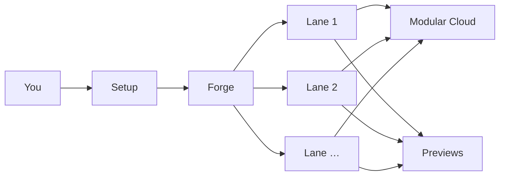

# Forge

Minimal **Python** **one-shot** compare demo for **3D web apps**: one prompt, **1-4 models at frontier level** on Modular Cloud, parallel Goose sandboxes (live trace + iframe preview).

## How it works

You pick a prompt and **1-4 models at frontier level**. The server runs one **Goose agent per model** in parallel, streams trace to the compare page, and loads each built app from its own sandbox when preview is ready.



Detail (diagrams, HTTP, Goose wiring): **[docs/how-it-works.md](docs/how-it-works.md)**.

## Requirements

- Python 3.12+
- [uv](https://docs.astral.sh/uv/getting-started/installation/) (recommended; creates and uses a project `.venv`)
- **[Goose CLI](https://goose-docs.ai/docs/getting-started/installation)** on `PATH` (install the binary only). You do **not** need to run `goose configure` for this demo: each lane writes Goose config under `data/goose/<run_id>/`, sets `GOOSE_PATH_ROOT`, passes `--provider` / `--model` / `--max-turns` on the CLI, and injects your API key into the subprocess environment.
- **`MODULAR_API_KEY`** (or `MODULAR_CLOUD_API_KEY`) in `.env`. See `.env.example`.

## Setup

1. **Get the app tree:** clone the repo that contains Forge (in the **`forge/`** folder), or copy the **`forge/`** folder to wherever you want to run it (any path is fine; all paths below are from that folder root).

2. **Virtual env + dependencies** (from the `forge/` root):

```bash
cd /path/to/forge
uv venv
uv sync
cp .env.example .env
# set MODULAR_API_KEY. See .env.example
```

`uv sync` installs into `.venv/` in this directory. You can also `source .venv/bin/activate` and use `forge` directly instead of `uv run`.

## Run

```bash
cd /path/to/forge
uv run forge
# http://127.0.0.1:8765
```

- **Setup (`/`):** preset or custom prompt, pick models, **Run compare**.
- **Compare (`/compare`):** one active session per server process; lane SSE + preview if `window.__forgeReady = true` in `index.html`.
- **Cancel:** a new compare stops in-flight Goose lanes (confirm only when lanes are still running). `GET /api/compare/in-flight` drives that check.
- **Turn limit:** each lane passes Goose `--max-turns` from `MAX_AGENT_TURNS_PER_LANE` in `forge/env.py` (default **80**). Same cap for every lane; not in the UI or `.env`. Change the constant to allow longer runs.

```bash
uv run python scripts/e2e_smoke.py   # HTTP checks; live 2-lane compare if .env + goose (FORGE_E2E_LIVE=0 to skip live)
```

## Config

| File | Purpose |
|------|---------|
| `config/models.yaml` | Lane profiles (MiniMax M3, M3.1 Flash, DeepSeek V4.1 Flash, Gemma 4 31B) |
| `config/prompts.yaml` | Preset briefs + card subtitles |
| `config/constraints.txt` | Shared build rules (appended to every lane) |
| `config/threejs_3d.txt` | Extra 3D block for solar-system, racing, Eiffel presets |
| `config/agent_playbook.txt` | Shared Goose workflow |
| `config/pricing.yaml` | Optional $/1M labels on setup tiles |
| `vendor/` | **Three.js r160 template** copied into each lane sandbox (see `vendor/README.md`) |

Sandboxes: `data/sandbox/<run_id>/` (gitignored).

## Scope

- One compare at a time per server process; results are not persisted after restart.
- Lane output lives under `data/sandbox/`; Goose trace streams over SSE on `/compare`.
- Preview iframe loads only when the lane sets `window.__forgeReady = true` in its `index.html`.
- Three.js for 3D presets comes from repo-root `vendor/` (copied per lane), not a CDN. See `vendor/README.md`.

## Mapping from a minimal agent script

If you already have a short Python loop (Modular Cloud chat + tools writing into an `app/` folder), the same ideas appear here under different names. You can change prompts, models, and rules in `config/` without touching the compare UI.

| You might already have | In Forge |
|------------------------|---------------|
| `MODULAR_API_KEY` and `base_url` | `.env` plus per-lane env on the Goose subprocess |
| `MODEL = "…"` | One row in `config/models.yaml` |
| System + user messages | `forge/prompts.py` → one `--text` prompt for Goose |
| Tool loop → `app/index.html` | Goose **developer** builtin → `data/sandbox/<run_id>/` |
| `for _ in range(N)` turn cap | `MAX_AGENT_TURNS_PER_LANE` in `forge/env.py` |
| Open `app/index.html` | Preview when `window.__forgeReady = true` in the sandbox |

Where to look first: `config/`, then `forge/prompts.py`, `models.py`, `env.py`, `goose_runner.py`. Multi-lane orchestration and HTTP live in `compare.py` and `app.py`. More detail in [docs/how-it-works.md](docs/how-it-works.md).

## Layout

Project root (your `forge/` copy):

```
forge/
  docs/            how-it-works.md (architecture detail)
  config/          prompts, models, constraints, pricing
  forge/      app, Goose runner, SSE, compare session
  templates/       setup + compare + agent-prompt dialog
  static/          app.css, compare.js, setup.js, building-wait.html
  vendor/          vendored Three.js (copied per lane)
  scripts/         e2e_smoke.py
  data/            sandboxes (gitignored)
  .venv/           local virtualenv (gitignored; created by uv)
```
