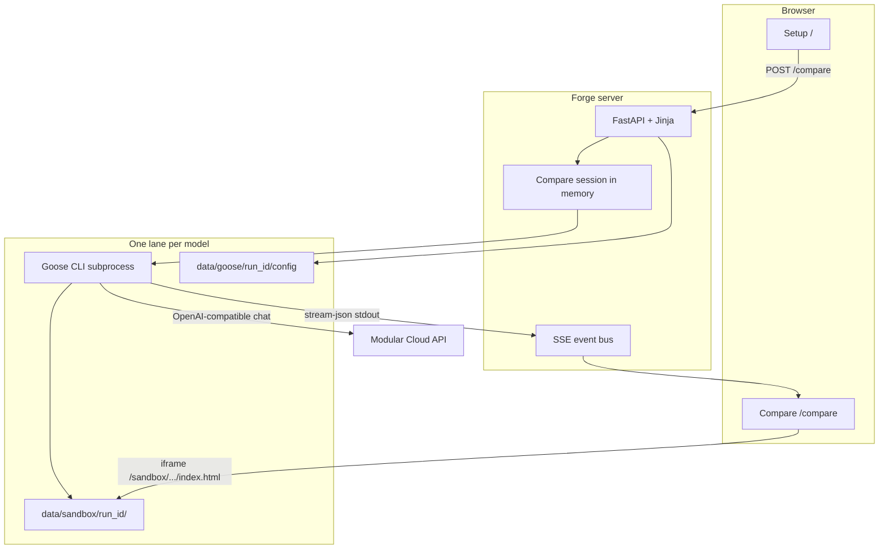
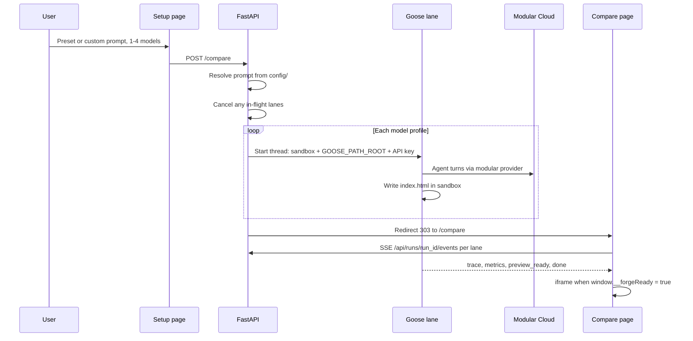

# How Forge works

Forge is one **Python process** (FastAPI) that runs **one compare at a time**. Each selected model gets its own **Goose subprocess**, **sandbox directory**, and **SSE stream**. All models share the same resolved prompt and fair-compare rules from `config/`.

## System overview



## Compare sequence



## HTTP routes

| Route | Role |
|-------|------|
| `GET /` | Setup: presets, custom prompt, model tiles |
| `POST /compare` | Start compare (1-4 profiles); redirect to `/compare` |
| `GET /compare` | Compare UI (404 if no active session) |
| `GET /api/compare/in-flight` | JSON `{ "in_flight": bool }` for cancel confirm |
| `GET /api/runs/{run_id}/events` | SSE for one lane |
| `GET /sandbox/{run_id}/…` | Agent-built files (preview iframe) |

## Prompt and lane wiring

| Step | What happens |
|------|----------------|
| Prompt | `config/prompts.yaml` preset or custom text, plus `constraints.txt`, `agent_playbook.txt`, optional `threejs_3d.txt` for 3D presets |
| Models | `config/models.yaml` maps each lane to `--provider modular`, model id, and `MODULAR_API_KEY` |
| Goose | Per lane: write `custom_providers/modular.json`, set `GOOSE_PATH_ROOT`, copy `vendor/` into sandbox, run `goose run --text … --max-turns N` |
| Preview | Lane **Complete** when Goose exits and `index.html` sets `window.__forgeReady = true` after first render |

### Prompt assembly

`forge/prompts.py` builds one string for Goose `--text`:

1. Preset **brief** or custom text from the form  
2. Optional **threejs_3d.txt** block for solar-system, sunset-circuit, eiffel-tower  
3. **constraints.txt** (static files, preview gate, no CDN, and similar rules)  
4. **agent_playbook.txt** (workflow hints)

Custom prompt mode can supply a preassembled blob; otherwise the four parts are joined with newlines.

### API key and Goose setup

- `.env` loads `MODULAR_API_KEY` or `MODULAR_CLOUD_API_KEY` (`forge/env.py`).  
- Each lane subprocess gets that value on the env var named in the profile (default `MODULAR_API_KEY`).  
- Goose does **not** use your global `goose configure` profile: `GOOSE_PATH_ROOT` points at `data/goose/<run_id>/` with a generated **modular** custom provider (base URL `https://api.modular.com/v1/chat/completions`, model list from `models.yaml`).  
- `GOOSE_DISABLE_KEYRING=1` and `GOOSE_MODE=auto` keep headless runs non-interactive.

### Turn limit

`MAX_AGENT_TURNS_PER_LANE` in `forge/env.py` (default **80**) is passed as Goose `--max-turns` for every lane. Not exposed in the UI or `.env`.

### Cancel and supersede

Starting a new compare bumps an internal generation counter and **terminates** in-flight Goose processes for the previous session. Lanes that stop this way emit a cancel message on SSE. The setup page calls `GET /api/compare/in-flight` before confirming when a compare is still running.

## Mapping from a minimal agent script

If you already have a short Python loop (Modular Cloud chat + `write_file` / `read_file` into an `app/` folder), the same pieces exist here with different names. You do **not** need to touch the compare UI to change prompts, models, or build rules.

| You might already have | In Forge |
|------------------------|---------------|
| `MODULAR_API_KEY` and `base_url` | `.env` plus per-lane env on the Goose subprocess (`forge/env.py`, `goose_runner.py`) |
| `MODEL = "…"` | One row in `config/models.yaml` |
| System + user messages | `ResolvedPrompt.agent_prompt` built in `forge/prompts.py` from yaml/txt under `config/` |
| Tool loop writing `app/index.html` | Goose **developer** builtin writing `data/sandbox/<run_id>/` (no in-process `OpenAI` loop) |
| `for _ in range(N)` turn cap | `MAX_AGENT_TURNS_PER_LANE` in `forge/env.py` → Goose `--max-turns` |
| Open `app/index.html` | Preview iframe when the lane sets `window.__forgeReady = true` |

### Where to look first

```
config/              presets, models, constraints, playbook, pricing
forge/
  prompts.py         assembles the single `--text` prompt for Goose
  models.py            profiles loaded from models.yaml
  env.py               API key resolution and turn cap
  goose_runner.py      one lane: sandbox, Goose config, subprocess, SSE
  compare.py           multi-lane session (only for parallel compare)
  events.py            in-memory run state + SSE formatting
  app.py               HTTP routes, templates, sandbox static files
templates/ static/   setup and compare UI (optional if you only hack config)
```

One lane in the diagrams above is logically the same job as a single script run. Forge adds an in-memory **session**, **SSE** trace on the compare page, and **1-4 lanes** at once. Fair-compare rules (shared constraints, offline `vendor/` instead of a CDN) live in `config/`; adjust those files rather than reintroducing CDN or per-lane secrets in the UI.

## Data on disk (gitignored at runtime)

| Path | Purpose |
|------|---------|
| `data/sandbox/<run_id>/` | Agent output (`index.html`, assets, copied `vendor/`) |
| `data/goose/<run_id>/` | Per-lane Goose config (`custom_providers/modular.json`, `permission.yaml`) |

Nothing is persisted across server restarts except files left on disk under `data/`.

## SSE event types (lane)

The compare page subscribes to `/api/runs/{run_id}/events`. Common event types include:

- `run_started` – lane profile, model id, preview URL hint  
- `trace` / `log` – trimmed Goose stdout/stderr for the UI  
- `metrics` – token usage and optional cost labels from `config/pricing.yaml`  
- `preview_ready` – sandbox `index.html` changed (iframe may still wait for `__forgeReady`)  
- `error` / `done` – terminal state, exit code, `has_preview` flag  

## Scope and non-goals

- No SQLite, arena history, or Playwright promotion (see full Forge for that stack).  
- No recipe YAML or registry sync.  
- Static config only under `config/`.  
- One active compare session per server process.
